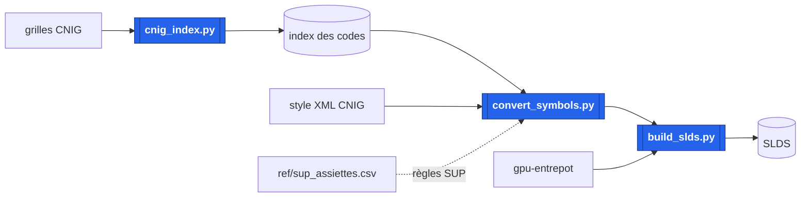

# sg5-to-gpu

Styles GeoServer (SLD) du Géoportail de l’Urbanisme (GPU) pour les symboles CNIG PLU, PSMV et SUP, produits automatiquement à partir du dépôt **[DDU-SG5-SYMBOLISATION](https://github.com/cnigfr/DDU-SG5-SYMBOLISATION)**, et **planche de contrôle publiée sur GitHub Pages**.

**→ [Planche de contrôle](https://floriancerizay.github.io/sg5-to-gpu/)**

La planche confronte chaque symbole produit au catalogue PDF du CNIG, au rendu QGIS des styles CNIG et aux styles actuels du GPU, et liste les **problèmes du symbole d’origine** à remonter au CNIG. La conversion des symboles QGIS en SLD est faite ici (`bin/qgis2sld.py`), sans retouche au cas par cas ni outil externe.

## Processus



Le catalogue PDF, les rendus GeoServer et QGIS et les diagnostics ne servent qu'à la [planche](https://floriancerizay.github.io/sg5-to-gpu/) et n'interviennent pas dans la construction des styles.

Détail de la construction des styles : [docs/chaine.md](docs/chaine.md). Construction de la planche : [docs/planche.md](docs/planche.md). Comportements de GeoServer contournés et limites : [docs/geoserver.md](docs/geoserver.md). Ce qui simplifierait la chaîne côté dépôt CNIG : [docs/propositions-cnig.md](docs/propositions-cnig.md).

## Installer

```bash
git submodule update --init                        # dépôt CNIG → cnig/ (ou git clone --recursive)
python3 -m venv .venv && .venv/bin/pip install -r requirements.txt
cp .env.example .env                               # puis adapter GPU_DIR, GEOSERVER_URL…
```

Prérequis système :

- `ogr2ogr` (GDAL), `pdftoppm` / `pdftotext` (poppler-utils), `fc-match` (fontconfig) ;
- **QGIS avec PyQGIS**, lancé par `/usr/bin/python3` (le `.venv` n’y a pas accès ; sinon `QGIS_PYTHON`) ;
- **GeoServer local démarré** (testé avec 2.28), avec droits d’écriture sur `styles/` de son data_dir.

## Lancer

```bash
./run.sh                                  # chaîne complète (~3 min)
./run.sh --from convert                   # après modification de qgis2sld / pattern_tiles / convert_symbols
./run.sh --from compare --sections plu_prescription,sup --skip-qgis   # essai rapide
```

| Option | Effet |
|--------|-------|
| `--from ÉTAPE` | Reprend à `index`, `plates`, `convert`, `slds` ou `compare` (sorties des étapes précédentes réutilisées). |
| `--sections S` | Ne traite que ces sections (la planche ne contient alors qu’elles) : `plu_prescription`, `plu_info`, `plu_zone_urba`, `plu_secteur_cc`, `psmv_…`, `sup`. |
| `--skip-qgis` | Pas de rendu QGIS : colonne QGIS vide, pas de mesure d’écart. |
| `--validate` | Étape `slds` : publication d’essai des SLD assemblés sur le GeoServer local, refus listés. |
| `-- …` | Options transmises à `bin/compare.py`. |

## Livrables

Outre la planche, la chaîne produit dans `data/` (non versionné) :

| Chemin | Contenu |
|--------|---------|
| `data/slds/` | SLD par couche GPU, organisés comme `STYLES/SLDS` de gpu-entrepot : `classiques/` (filtres par attributs métier) et `symboles/` (filtre `symbole = <code>`), avec `img/` et `fonts/` **à déployer avec eux** ; écarts aux styles de production dans `DIFFERENCES.md` |
| `data/symbols/script/` | un SLD par code CNIG |
| `data/symbols/issues.json`, `scores.json` | problèmes du symbole d’origine, écart au rendu QGIS par code |