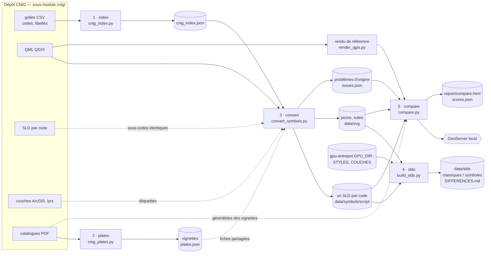

# sg5-to-gpu

Styles GeoServer (SLD) du Géoportail de l’Urbanisme (GPU) pour les symboles CNIG PLU, PSMV et SUP, produits automatiquement à partir du dépôt **[DDU-SG5-SYMBOLISATION](https://github.com/cnigfr/DDU-SG5-SYMBOLISATION)**, et **planche de contrôle publiée sur GitHub Pages**.

La planche confronte chaque symbole produit au catalogue PDF du CNIG, au rendu QGIS des QML CNIG et aux styles actuels du GPU, et liste les **problèmes du symbole d’origine** à remonter au CNIG. La conversion QML → SLD est faite ici (`bin/qml2sld.py`), sans retouche au cas par cas ni outil externe.

## La planche

Un tableau unique (en-tête figé), une section par couche, une ligne par fiche du catalogue :

| Colonne | Contenu |
|---------|---------|
| code / libellé | codes de la fiche (`surf.`, `lin.`, `pct.`) et classement |
| attendu (catalogue CNIG) | vignette du catalogue PDF |
| QGIS (QML CNIG) | QML CNIG rendu par QGIS |
| Script | SLD produit par la chaîne |
| problèmes du symbole d’origine | diagnostics de `issues.json` par géométrie, écart au rendu QGIS > 5, fiche sans vignette |
| prod actuelle | styles de production actuels (tout à droite) |

Elle est générée en local dans `report/` (`compare.html`, ≈ 19 Mo, pages statiques à chemins relatifs : `python3 -m http.server -d report` pour la consulter), puis commitée. Chaque push sur `main` qui modifie `report/` la publie sur GitHub Pages (`.github/workflows/pages.yml` : simple copie, aucun calcul en CI ; réglage du dépôt : Settings → Pages → Source « GitHub Actions »).

## Processus



Détail de chaque étape : [docs/chaine.md](docs/chaine.md). Comportements de GeoServer contournés et limites : [docs/geoserver.md](docs/geoserver.md).

## Installer

```bash
git submodule update --init                        # dépôt CNIG → cnig/ (ou git clone --recursive)
python3 -m venv .venv && .venv/bin/pip install -r requirements.txt
cp .env.example .env                               # puis adapter GPU_DIR, GEOSERVER_URL…
```

Prérequis système :

- `ogr2ogr` (GDAL), `pdftoppm` / `pdftotext` (poppler-utils), `fc-list` / `fc-match` (fontconfig) ;
- un **clone de gpu-entrepot** (styles, pictogrammes et couches de production GPU), désigné par `GPU_DIR` ;
- **QGIS avec PyQGIS**, lancé par `/usr/bin/python3` (le `.venv` n’y a pas accès ; sinon `QGIS_PYTHON`) ;
- **GeoServer local démarré** (testé avec 2.28), avec droits d’écriture sur `styles/` de son data_dir. Port 8080 pris : `JETTY_OPTS=jetty.http.port=8090 bash /usr/share/geoserver/bin/startup.sh`. Quand de nouvelles polices sont installées, le script demande de redémarrer GeoServer ;

## Lancer

```bash
./run.sh                                  # chaîne complète (~3 min)
./run.sh --from convert                   # après modification de qml2sld / pattern_tiles / convert_symbols
./run.sh --from compare --sections plu_prescription,sup_assiette --skip-qgis   # essai rapide
```

| Option | Effet |
|--------|-------|
| `--from ÉTAPE` | Reprend à `index`, `plates`, `convert`, `slds` ou `compare` (sorties des étapes précédentes réutilisées). |
| `--sections S` | Ne traite que ces sections (la planche ne contient alors qu’elles) : `plu_prescription`, `plu_info`, `plu_zone_urba`, `plu_secteur_cc`, `psmv_…`, `sup_symbole`, `sup_assiette`. |
| `--skip-qgis` | Pas de rendu QGIS : colonne QGIS vide, pas de mesure d’écart. |
| `--validate` | Étape `slds` : publication d’essai des SLD assemblés sur le GeoServer local, refus listés. |
| `-- …` | Options transmises à `bin/compare.py`. |

Réglages (`.env`, voir `.env.example` ; une variable déjà exportée prime) :

| Variable | Défaut | Rôle |
|----------|--------|------|
| `GPU_DIR` | **obligatoire** | Clone de gpu-entrepot (absolu ou relatif à la racine du dépôt) |
| `GEOSERVER_URL`, `GEOSERVER_USER`, `GEOSERVER_PASSWORD` | `http://localhost:8080/geoserver`, `admin`, `geoserver` | GeoServer de test (workspace `gpu_cmp` supprimé puis recréé à chaque passe) |
| `GEOSERVER_STYLES_IMG` | `/usr/share/geoserver/data_dir/styles/img` | `styles/img` du data_dir : images et polices sont copiées à côté |
| `QGIS_PYTHON` | `/usr/bin/python3` | Interpréteur ayant accès à PyQGIS |
| `SLD_IMG_URL` | `https://data.geopf.fr/annexes/gpu/geoserver/images/cnig/` | Préfixe des images dans les SLD livrés (`data/slds`) |

Autres réglages (chemins, nom de la géométrie…) : `config.py`.

## Mettre à jour et publier

- **Dépôt CNIG** (sous-module `cnig/`) : `./bump.sh` passe au dernier commit de la branche `SYMBOLISATION` (ou `./bump.sh <sha>`), liste les codes ajoutés / modifiés / supprimés (`data/cnig_diff.json`) et régénère la planche.
- **Production GPU** : mettre à jour le clone `GPU_DIR` (`git pull`), puis `./run.sh`. La version utilisée est affichée au début de `./run.sh`.
- **Publier** : commiter ensemble `cnig`, `data/cnig_index.<sha>.json` et `report/` (noter dans le message la version de gpu-entrepot utilisée), puis pousser sur `main`.

## Livrables

Outre la planche, la chaîne produit dans `data/` (non versionné) :

| Chemin | Contenu |
|--------|---------|
| `data/slds/` | SLD par couche GPU, organisés comme `STYLES/SLDS` de gpu-entrepot : `classiques/` (filtres par attributs métier) et `symboles/` (filtre `symbole = <code>`), avec `img/` et `fonts/` **à déployer avec eux** ; écarts aux styles de production dans `DIFFERENCES.md` |
| `data/symbols/script/` | un SLD par code CNIG |
| `data/symbols/issues.json`, `scores.json` | problèmes du symbole d’origine, écart au rendu QGIS par code |
