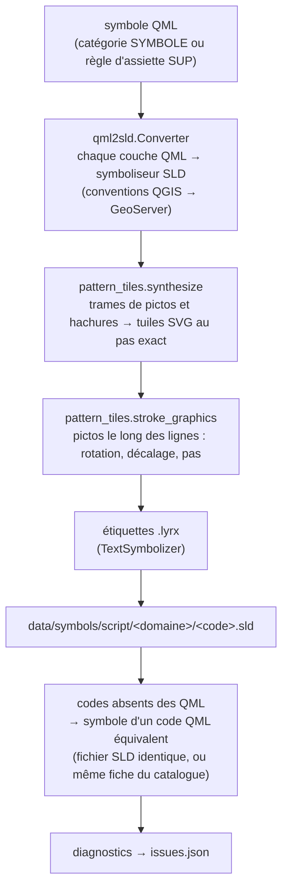

# Chaîne de production : détail

Référence technique des 5 étapes de `./run.sh` (vue d’ensemble et mode d’emploi : [README](../README.md)). Les chemins `STYLES/…` et `COUCHES/…` sont relatifs au clone de gpu-entrepot désigné par `GPU_DIR`.

## Sources CNIG utilisées

| Source (dépôt CNIG) | Rôle |
|---------------------|------|
| `*/QGIS/QML/*.qml` | **source des styles** (convertie par `qml2sld.py`) et référence de la mesure (rendu QGIS) |
| `__outils-agp-python-gdb__` (grilles) | liste des codes, libellés, attributs métier, étiquettes de fiche |
| `*/Catalogue_Symbolisation_CNIG_*.pdf` | rendu attendu (colonne « attendu »), fiches partagées entre sous-codes, géométries de test |
| `*/ArcGISpro/LYRX/*.lyrx` | étiquettes (zones `_ge`, PSMV PSC-x_39-50), seule source qui en définit |
| `PLU/SLD/<code>.sld`, `PSMV/SLD/<code>.sld` | **non utilisés comme styles** : seulement comparés entre eux pour rattacher un sous-code absent des QML au code QML dont le fichier est identique |

## Fichiers

| Fichier | Rôle |
|---------|------|
| `run.sh` | enchaîne les 5 étapes, vérifie les prérequis (lit `.env`) |
| `config.py` | chemins (`cnig/`, `GPU_DIR`, `data/`, `report/`), GeoServer, surcharges `.env` |
| `bin/cnig_index.py` | 1. index des codes |
| `bin/cnig_plates.py` | 2. vignettes du catalogue |
| `bin/convert_symbols.py` | 3. bibliothèque de symboles, sous-codes, étiquettes, diagnostics |
| `bin/build_slds.py` | 4. SLD par couche GPU (classiques et par symbole) |
| `bin/qml2sld.py` | conversion QML → symboliseurs SLD |
| `bin/pattern_tiles.py` | tuiles de trame, pictos le long des lignes |
| `bin/sld_normalize.py` | lecture / écriture des SLD au format de production (`sld:` / `ogc:`) |
| `bin/geoserver.py` | appels au GeoServer local (REST, WMS) |
| `bin/compare.py`, `bin/render_qgis.py` | 5. grille de test, rendus GeoServer / QGIS, écarts, planche |
| `bump.sh` | montée de version du dépôt CNIG (sous-module `cnig/`, codes modifiés, planche) |
| `.github/workflows/pages.yml` | publication de `report/` sur GitHub Pages |

## Conversion d’un symbole (étape 3)

## 1. `index` — codes CNIG (`bin/cnig_index.py`)

Liste les **1167 codes** (version 2a50e2c) (`PSC-S_01-03_001`, `ZONE_U_001_pe`, `AC1|gen_classe|ass_mh`…) des grilles CNIG avec domaine, couche GPU, attributs métier (`typepsc`/`stypepsc`, `typeinf`/`stypeinf`, `typezone`, `suptype`), libellé, étiquette de fiche, fichiers sources et empreinte.

- Sortie : `data/cnig_index.json` + archive `data/cnig_index.<sha>.json`.
- `bin/cnig_index.py --since <sha>` liste les codes ajoutés / modifiés / supprimés depuis une version antérieure (appelé par `./bump.sh`, sortie `data/cnig_diff.json`).

## 2. `plates` — vignettes du catalogue (`bin/cnig_plates.py`)

Rastérise les catalogues PDF (150 dpi), repère les fiches par leur texte et découpe la vignette « rendu attendu » : sous l’étiquette `tt-ss_nnn` (une fiche peut couvrir une plage de codes : « 15-00 à 98_001 »), les vignettes ≥ / < 1:2500 des zonages (`_ge` / `_pe`), le dessin des fiches SUP.

- Sorties : `report/cnig/*.png`, `report/cnig/plates.json` (`"domaine:code" → vignette`).

## 3. `convert` — un SLD par code (`bin/convert_symbols.py`)

Pour chaque QML CNIG (catégories `SYMBOLE`, règles d’`ASSIETTE_SUP_S`) : conversion du symbole, tuiles, pictos de ligne, étiquettes, puis écriture d’un SLD par code (`Name` = code, `Title` = libellé, filtre `symbole = code`, hrefs relatifs `X.svg?…`).

### Conversion des couches QML (`bin/qml2sld.py`)

| Couche QML | SLD | Points traduits |
|------------|-----|-----------------|
| `SimpleLine` | `LineSymbolizer` | couleur, épaisseur (≥ 0,7 px), extrémités, jointures ; tireté personnalisé ou style Qt (`dash`, `dot`, `dash dot` : EL3) ; décalage du tireté (`dash_pattern_offset` : tiretés bicolores de PSC-L_07) ; décalage latéral |
| `MarkerLine` (intervalle) | `LineSymbolizer` / `GraphicStroke` | picto, pas = intervalle QML, angle et décalage du picto, décalage le long de la ligne et latéral |
| `SimpleFill` | `PolygonSymbolizer` | remplissage plein ou aucun, contour (couleur, épaisseur, style) |
| `PointPatternFill` | `PolygonSymbolizer` / `GraphicFill` | pas (`distance_x/y` → marges), origine de la trame (`offset_x/y` en % ou en unités) et décalage du picto (position relative des trames superposées : PSC-S_37, « RP » de PSC-S_56, « Pb » d’INF-S_17) |
| `LinePatternFill` | `PolygonSymbolizer` / `GraphicFill` `shape://` | pas, angle, décalage le long de la normale au trait, trait du sous-symbole |
| `CentroidFill` | `PointSymbolizer` | picto au centroïde |
| `SimpleMarker` | `Mark` | `circle`, `square`, `triangle`, `star`… ; `diamond` = carré tourné de 45° ; `line` = `shape://vertline` ; contour aux valeurs par défaut de QGIS (#232323, épaisseur 0 = trait fin) |
| `SvgMarker` | `ExternalGraphic` | SVG embarqué (base64) → `data/svg`, nommé comme le SVG CNIG de même contenu (PSMV préfixé `psmv_`, sinon `qml_<hash>.svg`) ; la taille QGIS est la largeur, la taille SLD la hauteur ; couleurs en paramètres (`?fill=…`) |
| `FontMarker` | `Mark ttf://Police#0xNN` | caractère, couleur, contour (aucun si épaisseur 0) |
| `EllipseMarker` | `ExternalGraphic` | SVG généré (rectangle, ellipse : INF-S_20) |

Couches désactivées ignorées (y compris une couche dont toutes les sous-couches le sont, ex. point blanc de PSC-L_07-00_001). Ordre de dessin = ordre des couches du QML.

### Tuiles de trame (`pattern_tiles.synthesize`)

Chaque remplissage à motif (pictos, marques, caractères de police, hachures continues ou tiretées hors 45°) devient une **tuile SVG** `data/svg/pat_<hash>.svg` :

- taille exacte pas_x × pas_y, motif centré (décalé du `Displacement`), rotation, opacité et couleurs intégrées ;
- caractères de police convertis en tracés SVG (fontTools) avec la convention de taille de QGIS (taille de police, centrage sur la chasse, ligne de base à ascent / 2) ; police cherchée dans `data/fonts` (rempli au début de l’étape 3 depuis `STYLES/data/fonts` et la police Mostly du dépôt CNIG) puis via fontconfig ;
- trames superposées de même pas (à 5 % près) fusionnées dans une seule tuile ; un picto plus grand que le pas garde le pas exact ;
- décalage aléatoire des points (QGIS `random_deviation_x/y`, graine `seed` : INF-S_36) reproduit par cellule sur une tuile d’au moins 96 px, raccordable ;
- hachures : tuile périodique d/|sin θ| × d/|cos θ| traversée par les traits ; hachures de même angle et même pas fusionnées (écart entre traits conservé : PSC-S_02-xx) ; tiretés horizontaux / verticaux (tuile d × période du tiret) et obliques hors 45° (tirets partant d’une même perpendiculaire, période ajustée) ;
- tuile répétée k × k pour dépasser 16 px et tomber sur des pixels entiers (sinon coutures), `graphic-margin` = -1 (bordure GeoServer).

Restent natives : marques de police hors trames (symboles ponctuels), hachures tiretées à 45° (`shape://slash|backslash`, correctes).

### Pictos le long des lignes (`pattern_tiles.stroke_graphics`)

- rotation intégrée à une copie du SVG `data/svg/rot_<hash>.svg` ;
- décalage du picto (repère du picto, tourné avec la ligne comme QGIS) : composante le long de la ligne → `stroke-dashoffset`, composante latérale → `PerpendicularOffset` (tirets de PSC-x_25, triangles de PSC-L_41) ;
- pas = intervalle QML, appliqué après rotation (flèches de PSC-L_39) ; 1er picto calé sur le début de la ligne comme QGIS ;
- picto du début de la ligne (que GeoServer ne dessine pas, à cheval sur l’extrémité) ajouté en `PointSymbolizer` sur `startPoint(the_geom)`, tourné selon `startAngle` (étoiles de PSC-L_07) — pour les pictos sans décalage ; nom de l’attribut géométrique : `GEOMETRY_NAME` ;
- contours de polygone : image du picto retournée de 180° (GeoServer l’oriente à l’inverse de QGIS, le décalage latéral restant du bon côté : triangles d’INF-S_04 / 33) ;
- décalages de tous les tiretés d’un symbole choisis ensemble (pictos et traits de période égale ou multiple) : étoiles superposées et trait bicolore de PSC-L_07 qui change de couleur à chaque étoile.

### Étiquettes (`lyrx_labels`)

Les QML et SLD CNIG n’en définissent pas : les classes d’étiquettes visibles des `.lyrx` dont la clause `where` vise un code ou un attribut métier (`typzone = 'U'`) et dont le texte vient d’un champ (`$feature.typzone` → attribut GPU `typezone`) deviennent des `TextSymbolizer` (police, taille, couleur, halo). Les étiquettes à texte constant (« 12 » des PSMV PSC-x_39-50), absentes du QML et de la vignette du catalogue, ne sont pas reprises (signalé).

- **Police** : fichier déposé dans `STYLES/data/fonts`, sinon police système, sinon substitut libre (Century Gothic → URW Gothic, Times New Roman → Liberation Serif) ; fichiers copiés dans `data/fonts` puis sur GeoServer (redémarrage demandé si nouvelle police).
- **Halo des zones** : couleur de la zone (1er trait non gris du symbole QML) quand le `.lyrx` diverge (AUc : halo noir dans le `.lyrx`, rouge dans le catalogue comme pour les autres zones) ; signalé.

### Codes absents des QML

Symbole du code QML dont le fichier SLD CNIG est identique, sinon d’un code QML présenté sur la même fiche du catalogue (même couche, même variante) — le code de base `tt-00` de préférence (« 15-00 à 98_001 »), sinon le premier de la fiche (« 19-01 à 02_001 »). À défaut, **aucun style** : signalé.

### Diagnostics → `data/symbols/issues.json`

« ⚠ » défaut ou partie non reproductible, « ℹ » information :

| Message | Détection |
|---------|-----------|
| ⚠ aucun style CNIG (ni QML, ni fichier SLD par code) | code des grilles sans symbologie (PSC-S_26-01_001, 71 codes SUP) |
| ⚠ absent des QML CNIG …, sans code QML équivalent ni fiche partagée : aucun style produit | sous-code non rattachable |
| ⚠ absent des QML CNIG … ; son fichier … diffère de celui de <base> ; même fiche du catalogue | le fichier SLD du sous-code contredit sa fiche (barre rouge de PSC-P_15-01) |
| ℹ absent des QML CNIG … : style de … (fichier SLD identique) | sous-code rattaché à son jumeau |
| ℹ pas de fichier SLD CNIG pour ce code (QML seul) | — |
| ⚠ couche / picto / marque QGIS … non traduit(e) | élément QML sans équivalent |
| ⚠ motif presque jointif : picto … pour un pas de … | picto-texture qui déborde du pas de 2 à 25 % : recouvrements et bandes, aussi sous QGIS (INF-S_09) |
| ⚠ pictogramme … manquant | `xlink:href` sans fichier |
| ⚠ pictogramme … : homonyme différent dans les styles de production | même nom de fichier que `STYLES/data/fonts/`, dessin différent — collision si les deux jeux partagent un dossier d’images |
| ℹ pictogramme du QML absent des SVG CNIG | picto embarqué dans le QML seulement |
| ℹ étiquette reprise de la couche ArcGIS (.lyrx) | étiquette hors QML |
| ⚠ police d’étiquette … absente … remplacée par … | police non fournie : substitut libre utilisé (à remplacer en déposant le fichier dans `STYLES/data/fonts`) |
| ⚠ halo de l’étiquette du .lyrx … différent de la couleur de la zone | incohérence `.lyrx` / catalogue (AUc) : couleur de la zone retenue |
| ℹ étiquette « … » du .lyrx non reprise | étiquette à texte constant |
| ℹ marque de police … | marque hors trame : rendu dépendant des polices de GeoServer |

Sorties : `data/symbols/script/<domaine>/<code>.sld`, `data/symbols/script/index.json`, `data/symbols/script/sup_rules.json` (+ `sup_rules/*.sld`), `data/symbols/issues.json`, `data/svg/`.

## 4. `slds` — SLD par couche GPU (`bin/build_slds.py`)

Assemble les SLD par code de l’étape 3 en deux jeux, organisés comme `STYLES/SLDS` de gpu-entrepot, avec `notsup` renommé `du` (`du/<couche>_du|_psmv.sld`, `sup/<catégorie>/<table>.sld`, catégories et tables de `COUCHES/CouchesWMS.csv` et `COUCHES/supByCategory.json`) :

| | `data/slds/classiques` | `data/slds/symboles` |
|--|------------------------|----------------------|
| Filtre | attributs métier : `typepsc`/`stypepsc`, `typeinf`/`stypeinf`, `typezone`, suptype (règles d’assiette du QML SUP) | `symbole = <code>` |
| Variantes d’un même type / sous-type | la **première** (code trié) ; les autres listées dans `DIFFERENCES.md` | **toutes** |
| Sous-types absents du CNIG | règle de repli par type (`tt-autres`), symbole `tt-00` | — |
| Étiquettes des zones | `libelle` | `typezone` |
| Types absents du CNIG | règles de production (`STYLES/data/du`) conservées, filtre réduit aux valeurs non couvertes ; règles d’exclusion (« autres ») abandonnées | — |
| SUP sans règle CNIG, assiettes linéaires / ponctuelles | fragments de production (`STYLES/data/sup/<suptype>/<table>.xml`) | — |
| Couches hors CNIG | `document`, `municipality`, `scot`, `mec` copiés de `STYLES/SLDS/notsup` | — |

Échelles de **production** dans les deux jeux : informations / prescriptions < 1:15 000 ; zones et secteurs en deux règles, `lowscale` 1:15 000 – 1:150 000 (variante CNIG `_pe`) et `highscale` < 1:15 000 (`_ge`), alors que le CNIG bascule à 1:2 500 ; SUP : échelles de `STYLES/data/sup/<suptype>/assiette_sup_s.xml` au lieu du `scalemaxdenom` du QML.

Images : `data/slds/img/` (pictos et tuiles référencés, URL `SLD_IMG_URL` + `v=<sha1>`) ; polices : `data/slds/fonts/` (à installer dans `styles/fonts` du GeoServer). Tous les écarts (échelles, variantes écartées, règles de production conservées ou abandonnées, couches copiées, codes sans style) sont listés dans `data/slds/DIFFERENCES.md`.

## 5. `compare` — rendus et planche (`bin/compare.py`)

1. **Grille de test** `data/layer/compare.gpkg` : une couche par (domaine, couche GPU), avec les **géométries des vignettes du catalogue**, extraites des tracés vectoriels des PDF (`TEMPLATES`) : fiche prescription / information (polygone, ligne et point superposés dans une cellule par fiche `tt-ss_nnn`), croix des fiches de zonage, polygone des fiches SUP.
2. **Styles publiés** sur le GeoServer local (workspace `gpu_cmp` recréé) : `prod` = `STYLES/data/du/<couche>.sld` (ou `assiette_sup_s.sld`) appliqué aux attributs métier, `script` = SLD de l’étape 3. SVG et tuiles dans `GEOSERVER_CMP_IMG` (pictos de production dans `prod/`, noms en collision), URL suffixées de l’empreinte du contenu (`v=<sha1>`, cache GeoServer par URL).
3. **Rendus** à ≈ 1:1800 (0,5 m/px, 0,28 mm/px) : GetMap par (couche, style) ; QML CNIG d’origine rendus par QGIS sur la même emprise.
4. **Écarts au rendu QGIS** → `data/symbols/scores.json` : différence RVB moyenne après léger flou, en tolérant le déphasage des trames (QGIS cale les motifs sur l’objet, GeoServer sur l’image) ; signalé au-delà de 5.
5. **Planche** `report/compare.html`. Elle s’imprime ou s’enregistre en PDF depuis le navigateur (bouton « Imprimer / PDF » ou Ctrl+P) : A4 paysage, en-tête répété, une section par page, fiches jamais coupées ; la case « problème ou remarque » restreint aussi l’impression.

## Sorties

| Chemin | Contenu |
|--------|---------|
| `data/cnig_index.json` | index des codes CNIG |
| `data/symbols/script/` | un SLD par code, règles d’assiette SUP |
| `data/symbols/issues.json` | problèmes du symbole d’origine |
| `data/symbols/scores.json` | écart au rendu QGIS par code |
| `data/svg/` | pictogrammes, tuiles `pat_*.svg`, pictos tournés `rot_*.svg` |
| `data/slds/` | SLD par couche GPU `classiques/` et `symboles/` (`du/`, `sup/`), `img/` et `fonts/` **à déployer avec eux**, `DIFFERENCES.md` |
| `data/layer/compare.gpkg` | grille de test |
| `report/` | planche `compare.html` (versionnée), rendus `img/`, vignettes `cnig/` |

## Versions CNIG

### Version CNIG 2a50e2c (novembre 2026)

Les grilles PLU de cette version ont changé de forme ; la chaîne en tient compte :

- colonne `etiquette` vide pour les sous-codes, l’étiquette complète étant dans la nouvelle colonne `etq_total` : `etq_total` sert de repli (rattachement des vignettes du catalogue) ;
- variantes `_000` de classement « transparent » (symbole invisible, une par code) : **écartées** de l’index et de la conversion. Converties, elles donnaient une marque sans remplissage, que GeoServer dessine en gris, et elles prenaient la place du `_001` dans les SLD classiques (première variante par type / sous-type). Un objet `symbole = …_000` reste sans rendu ;
- QML PLU regroupés par couche (`INFO_LIN.qml`… au lieu de `plu_inf_l.qml`…).
