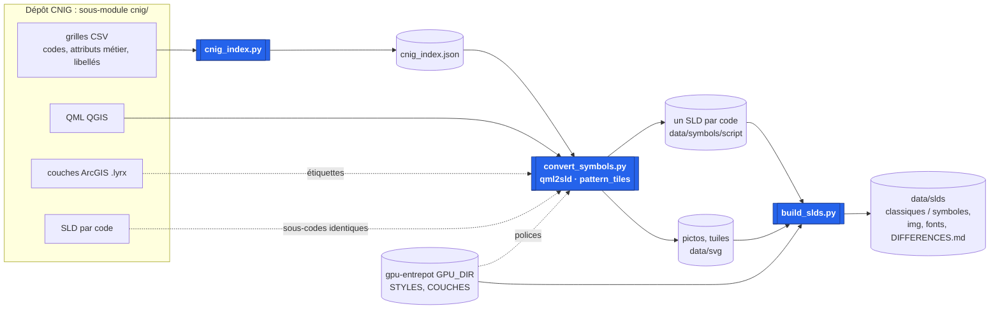

# Construction des styles

Comment `./run.sh` produit les SLD du GPU à partir du dépôt CNIG (mode d’emploi : [README](../README.md)). Les chemins `STYLES/…` et `COUCHES/…` sont relatifs au clone de gpu-entrepot (`GPU_DIR`). Le détail des conversions est dans les docstrings de `bin/qml2sld.py` et `bin/pattern_tiles.py`, les comportements de GeoServer contournés dans [geoserver.md](geoserver.md). La planche de contrôle est décrite à part : [planche.md](planche.md).

## Index des codes : `bin/cnig_index.py`

Lit les grilles CSV du CNIG (`__outils-agp-python-gdb__`) et liste les 1 167 codes (`PSC-S_01-03_001`, `ZONE_U_001_pe`, `AC1|gen_classe|ass_mh`…) avec domaine, couche GPU, attributs métier, libellé, fichiers CNIG et empreinte.

- Sortie : `data/cnig_index.json`, archivé en `data/cnig_index.<sha>.json` (versionné).
- `--since <sha>` : codes ajoutés, modifiés, supprimés depuis une version antérieure (`data/cnig_diff.json`), utilisé par `./bump.sh`.

## Un SLD par code : `bin/convert_symbols.py`

Pour chaque catégorie des QML CNIG (et chaque règle d’`ASSIETTE_SUP_S.qml`), écrit `data/symbols/script/<domaine>/<code>.sld` : une règle `symbole = <code>`, images en chemins relatifs vers `data/svg/`.

**Couches QML → symboliseurs SLD** (`qml2sld.py`) : les couches désactivées sont ignorées, l’ordre de dessin est celui du QML.

| Couche QML | SLD |
|------------|-----|
| `SimpleLine` | `LineSymbolizer` : couleur, épaisseur (≥ 0,7 px), tireté, décalages |
| `MarkerLine` | `LineSymbolizer` / `GraphicStroke` : picto répété au pas de l’intervalle QML |
| `SimpleFill` | `PolygonSymbolizer` : aplat, contour |
| `PointPatternFill` | `PolygonSymbolizer` / `GraphicFill` : trame de pictos |
| `LinePatternFill` | `PolygonSymbolizer` / `GraphicFill` : hachures |
| `CentroidFill` | `PointSymbolizer` au centroïde |
| `SimpleMarker`, `FontMarker` | `Mark` (forme connue, `ttf://Police#0xNN`) |
| `SvgMarker`, `EllipseMarker` | `ExternalGraphic` : SVG embarqué, renommé comme le SVG CNIG de même contenu, ou SVG généré |

**Contournements de GeoServer** (`pattern_tiles.py`, raisons dans [geoserver.md](geoserver.md)) :

- chaque trame (pictos, caractères de police, hachures hors 45°) devient une tuile SVG au pas exact, `data/svg/pat_<hash>.svg`, avec rotation et couleurs intégrées ; les trames superposées de même pas sont fusionnées ;
- les pictos le long des lignes sont tournés dans une copie du SVG (`rot_<hash>.svg`), leur décalage est reporté en `stroke-dashoffset` / `PerpendicularOffset`, et le picto de début de ligne est ajouté sur `startPoint`.

**Étiquettes** : seuls les `.lyrx` en définissent. Leurs classes visibles dont le texte vient d’un champ (`$feature.typzone`) deviennent des `TextSymbolizer`. La police est prise dans `STYLES/data/fonts`, sinon dans le système, sinon remplacée par un substitut libre ; le halo d’une zone prend la couleur de la zone quand le `.lyrx` diverge (AUc).

**Codes absents des QML** : symbole du code QML dont le SLD par code CNIG est identique, sinon du code principal (`tt-00`, ou à défaut le premier code QML du type ; en SUP, un code de la même servitude). À défaut, aucun style.

## SLD par couche GPU : `bin/build_slds.py`

Assemble les SLD par code en deux jeux organisés comme `STYLES/SLDS` de gpu-entrepot (`du/<couche>_du|_psmv.sld`, `sup/<catégorie>/<table>.sld`) :

| | `data/slds/classiques` | `data/slds/symboles` |
|--|------------------------|----------------------|
| Filtre | attributs métier (`typepsc`/`stypepsc`, `typeinf`/`stypeinf`, `typezone`, `suptype`) | `symbole = <code>` |
| Variantes d’un même sous-type | la première seulement | toutes |
| Sous-types absents du CNIG | repli par type, symbole `tt-00` | — |
| Ce que le CNIG ne couvre pas | règles de production conservées (`STYLES/data/du`, `STYLES/data/sup`), couches hors CNIG copiées (`document`, `scot`…) | — |

- Échelles : celles de la production (bascule des zones à 1:15 000, au lieu de 1:2 500 dans le CNIG).
- Images dans `data/slds/img/` (URL `SLD_IMG_URL`, suffixée de l’empreinte du fichier), polices dans `data/slds/fonts/` : à déployer avec les SLD.
- Tous les écarts au CNIG et à la production : `data/slds/DIFFERENCES.md`.
- `--validate` : publication d’essai de chaque SLD sur le GeoServer local.

## Particularités de la version CNIG 2a50e2c

- Grilles PLU : colonne `etiquette` vide pour les sous-codes, l’étiquette complète passe dans `etq_total` (utilisée en repli).
- Variantes `_000` « transparent » (symbole invisible) : écartées de l’index et de la conversion.
- QML PLU regroupés par couche (`INFO_LIN.qml`… au lieu de `plu_inf_l.qml`…).
