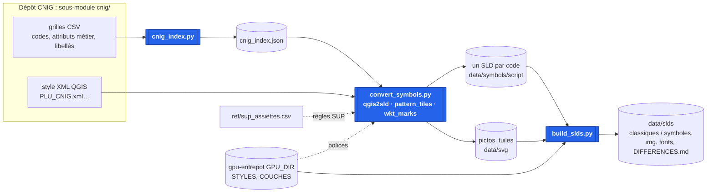

# Construction des styles

Comment `./run.sh` produit les SLD du GPU à partir du dépôt CNIG (mode d’emploi : [README](../README.md)). Les chemins `STYLES/…` et `COUCHES/…` sont relatifs au clone de gpu-entrepot (`GPU_DIR`). Le détail des conversions est dans les docstrings de `bin/qgis2sld.py` et `bin/pattern_tiles.py`, les comportements de GeoServer contournés dans [geoserver.md](geoserver.md). La planche de contrôle est décrite à part : [planche.md](planche.md).

## Index des codes : `bin/cnig_index.py`

Lit les grilles CSV du CNIG (`__outils-agp-python-gdb__`) et liste les 1 167 codes (`PSC-S_01-03_001`, `ZONE_U_001_pe`, `AC1|gen_classe|ass_mh`…) avec domaine, couche GPU, attributs métier, libellé, style XML et empreinte (sha1 du symbole XML). Les codes du style XML absents des grilles (`SECTEUR_xx`, zones PSMV, PSMV `PSC-L/P_05`) sont ajoutés en « hors-grille ». Les variantes « transparent » (`_000`, 431 codes PLU) sont listées à part (`transparent` : pas de style produit, symbole XML vérifié invisible), avec les symboles `_000` du XML sans ligne de grille (`PSC-S_38-03_000`). Ni les QML ni le dossier `SLD/` du CNIG (SLD par code, SVG) ne sont lus.

- Sortie : `data/cnig_index.json`, archivé en `data/cnig_index.<sha>.json` (versionné).
- `--since <sha>` : codes ajoutés, modifiés, supprimés depuis une version antérieure (`data/cnig_diff.json`), utilisé par `./bump.sh`.

## Un SLD par code : `bin/convert_symbols.py`

Pour chaque symbole de la bibliothèque de styles QGIS du domaine (`PLU/QGIS/PLU_CNIG.xml`, `PSMV_CNIG.xml`, `SUP_CNIG.xml`, un symbole nommé par code), écrit `data/symbols/script/<domaine>/<code>.sld` : une règle `symbole = <code>`, images en chemins relatifs vers `data/svg/`. **Les QML ne sont pas lus** (ni par la conversion, ni par l’index, ni par le rendu QGIS de la planche).

**Règles d’assiette SUP** (jeu « classiques », filtres par attributs) : une par ligne de `ref/sup_assiettes.csv` (`suptype`, `attribut`, `valeur` → `code` SUP dont le symbole XML est repris), dans `data/symbols/script/sup_rules/`. La table a été établie une fois depuis les règles d’`ASSIETTE_SUP_S.qml`, appariées aux codes par leur type d’assiette (`ass_mh` ↔ `typeass = Monument historique`…) ; quand plusieurs codes conviennent, ils ont le même dessin XML. Ligne sans code (T8, aucun code dans la grille) : règle de production conservée. La table est complétée d’après les règles de `STYLES/SLDS/sup/sup/assiette_sup_s.sld` de production qu’elle ne couvrait pas (AR3 « Zone de prohibition 1 », T5bis), colonne `remarque`. À remplacer par des colonnes de `grille_sup.csv` si le CNIG les ajoute.

**Couches de symbole QGIS → symboliseurs SLD** (`qgis2sld.py`) : les couches désactivées sont ignorées, l’ordre de dessin est celui du symbole.

| Couche de symbole QGIS | SLD |
|------------|-----|
| `SimpleLine` | `LineSymbolizer` : couleur, épaisseur (≥ 0,7 px), tireté, décalages |
| `MarkerLine` | `LineSymbolizer` / `GraphicStroke` : picto répété au pas de l’intervalle QGIS |
| `SimpleFill` | `PolygonSymbolizer` : aplat, contour |
| `PointPatternFill` | `PolygonSymbolizer` / `GraphicFill` : trame de pictos |
| `LinePatternFill` | `PolygonSymbolizer` / `GraphicFill` : hachures |
| `CentroidFill` | `PointSymbolizer` au centroïde |
| `SimpleMarker`, `FontMarker` | `Mark` (forme connue, `ttf://Police#0xNN`) |
| `SvgMarker`, `EllipseMarker` | `ExternalGraphic` : SVG embarqué dans le style XML, nommé d’après le code du symbole (`PSC-L_15-00_001.svg`, puis `_1`, `_2`…), ou SVG généré ; un seul fichier par dessin (copies PLU / PSMV, même dessin à une autre échelle), sauf picto à contour d’échelle différente |

**Contournements de GeoServer** (`pattern_tiles.py`, raisons dans [geoserver.md](geoserver.md)) :

- chaque trame (pictos, caractères de police, hachures, sauf les hachures à 45° dont le tiret tient dans la marque) devient une tuile SVG au pas exact, `data/svg/pat_<hash>.svg`, avec rotation et couleurs intégrées ; les trames superposées de même pas et les hachures croisées de même tuile sont fusionnées ; une trame seule que GeoServer rend juste (marque simple ou hachure continue, au pas entier, sans rotation hors multiple de 90° ni décalage) reste native ;
- les pictos le long des lignes sont tournés dans une copie du SVG (`rot_<hash>.svg`), leur décalage est reporté en `stroke-dashoffset` / `PerpendicularOffset`, et le picto de début de ligne est ajouté sur `startPoint`.

**Pictos natifs** (`wkt_marks.py`) : un picto ponctuel (`PointSymbolizer`, dont le picto de début de ligne) devient une marque `wkt://` : tracé du SVG aplati, couleurs des paramètres de l’URL, aucune image à charger. Les pictos le long des lignes (`GraphicStroke`) et les tuiles de trame restent des SVG.

**Étiquettes** : aucune n’est produite. Le style XML n’a que des formats de texte (apparence : police, taille, couleurs, halo), sans réglage d’étiquette (champ, placement) ; les `.lyrx` ne sont pas lus. Chaque format de texte est signalé sur le code correspondant (`ZONE_U_001_txt` pour `ZONE_U_001_ge` et `_pe`), les formats sans code dans l’encadré de la planche.

**Codes absents du style XML** (5 en version 5a838ff : PSMV `PSC-S_26-01`, `PSC-L/P_97-00`, `PSC-L/P_97-01`) : symbole du code principal (`tt-00`, ou à défaut le premier code du type ; en SUP, un code de la même servitude). À défaut, aucun style.

## SLD par couche GPU : `bin/build_slds.py`

Assemble les SLD par code en deux jeux organisés comme `STYLES/SLDS` de gpu-entrepot (`du/<couche>_du|_psmv.sld`, `sup/<catégorie>/<table>.sld`) :

| | `data/slds/classiques` | `data/slds/symboles` |
|--|------------------------|----------------------|
| Filtre | attributs métier (`typepsc`/`stypepsc`, `typeinf`/`stypeinf`, `typezone`, `suptype`) | `symbole = <code>` |
| Variantes d’un même sous-type | la première seulement | toutes |
| Sous-types absents du CNIG | repli par type, symbole `tt-00` | — |
| Ce que le CNIG ne couvre pas | règles de production conservées (`STYLES/data/du`, `STYLES/data/sup`), couches hors CNIG copiées (`document`, `scot`…) | — |

- Échelles : celles de la production (bascule des zones à 1:15 000, au lieu de 1:2 500 dans le CNIG).
- Images dans `data/slds/img/` (URL `SLD_IMG_URL`, suffixée de l’empreinte du fichier), polices dans `data/slds/fonts/` : à déployer avec les SLD.
- Tous les écarts au CNIG et à la production : `data/slds/DIFFERENCES.md`.
- `--validate` : publication d’essai de chaque SLD sur le GeoServer local.

## Particularités du dépôt CNIG

- Grilles PLU : colonne `etiquette` vide pour les sous-codes, l’étiquette complète passe dans `etq_total` (utilisée en repli).
- Variantes `_000` « transparent » (symbole invisible) : pas de style produit, listées à part dans l’index et dans les fiches de la planche.
